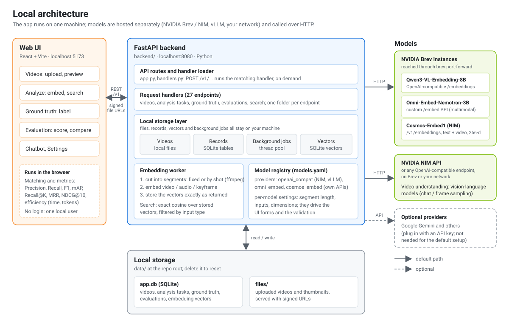
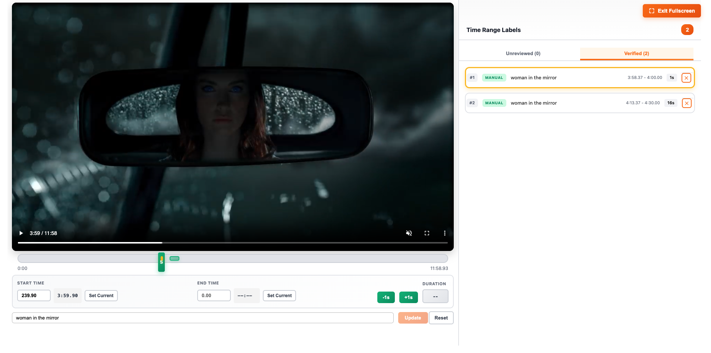
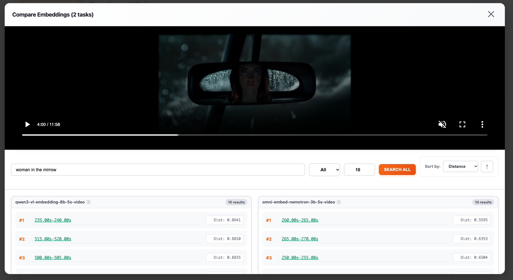
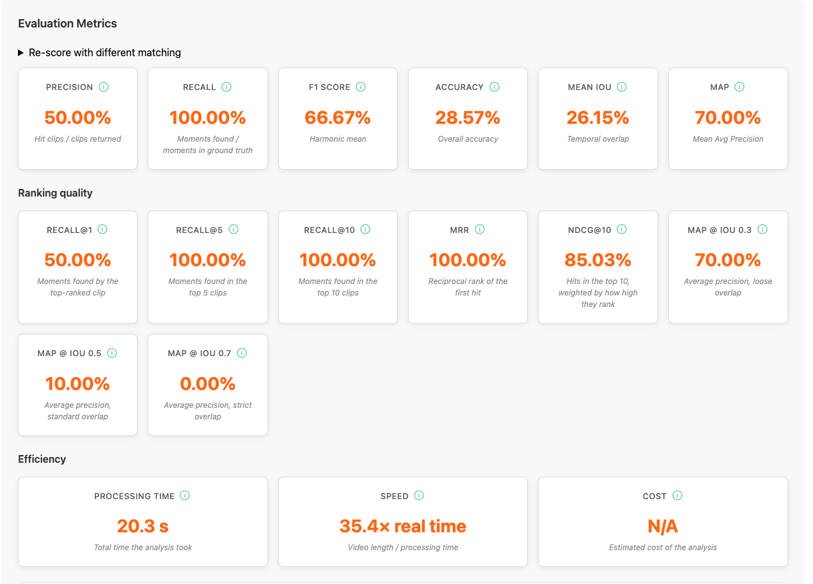

# Video Understanding Evaluation Framework

A flexible tool that streamlines video labeling and evaluation, enabling teams to work with their own data, reduce ground-truth bias, and accelerate model development.

> **Branches.** `main` runs entirely on your machine (FastAPI + SQLite + local files, models on NVIDIA Brev / NIM / any
> OpenAI-compatible endpoint). The original AWS serverless version (Lambda, API Gateway, DynamoDB, S3, Bedrock, Cognito and
> the CDK deployment) is kept on the [`aws-original`](https://github.com/lanazhang/video-understanding-evaluation-framework/tree/aws-original) branch.

## Why This Matters

Video understanding is a core growth driver in the GenAI market, enabling new revenue streams across media, advertising, education, retail, and enterprise. By transforming video into structured, actionable intelligence, it powers monetization use cases like contextual ads, shoppable content, personalization, and automation—making it a strategic capability, not just a technical one.

## The Challenge

Video understanding evaluation is uniquely complex:

- **Diverse use cases**: Event detection, scene understanding, labeling, and temporal reasoning often require multiple models rather than a single solution
- **Varied definitions**: "Events" differ widely across industries (M&E content moderation, sports events, IP camera surveillance)
- **Limited access**: Representative sample videos are often restricted by licensing constraints
- **Resource-intensive**: Ground-truth generation requires significant time and effort
- **Complex tooling**: Effective evaluation demands rich UI tools for labeling, visualization, and temporal analysis

From a data scientist's perspective, obtaining high-quality datasets and accurate labels is a major challenge. Diverse content, licensing limits, and complex event definitions make ground-truth generation resource-intensive, yet it's essential for efficient model training and reliable evaluation.

## Solution

This framework helps teams quickly assess customer-provided videos and recommend the most suitable models—not based on popularity or biased assumptions, but on actual data and use cases. It enables rapid insights, supports larger-scale ground-truth tasks, and improves model training by allowing evaluation across multiple models and methods.

### Key Features

- **User-uploaded videos & custom labeling**: Efficiently label videos for specific use cases, reducing dependence on public/licensed datasets and minimizing ground-truth bias
- **Cross-model comparison**: Compare video understanding (frame-sampling) and embedding-based methods side by side. NVIDIA-hosted models are the default (Qwen3-VL-Embedding-8B, Omni-Embed-Nemotron-3B, Cosmos-Embed1, NIM / OpenAI-compatible vision-language models); Gemini, Bedrock and other providers can be plugged in through `backend`'s model registry
- **Fixed or shot-based segmenting**: embed fixed-length segments, or let ffmpeg find the shots and cut there (long shots are divided evenly, tiny ones merged), for any embedding model
- **See how a video was segmented**: each embedding index draws its segments on a timeline (shots, long shots divided, zoom, click to play)
- **Human-in-the-loop efficiency**: Auto-label with a base model and quickly refine with human input, reducing labeling time from weeks to hours
- **Flexible evaluation workflow**: Compare outputs across models and methods to identify optimal solutions, adaptable for different industries and content types
- **Interactive review tools**: Side-by-side comparison of predicted vs ground truth labels with metrics (precision, recall, F1) and individual label verification

## Architecture



The web UI talks to a FastAPI backend over REST. The backend runs the original Lambda handlers in-process, with each AWS
service replaced by a local one (S3 by files, DynamoDB and S3 Vectors by SQLite, Lambda invokes by a thread pool), so the
whole app needs no AWS account and no Docker. Only the models are remote.

- **Upload**: the UI sends the video to the backend, which stores it under `data/files/` and records its metadata
  (duration, resolution, thumbnail) in SQLite.
- **Embed**: an embedding task cuts the video into segments, sends each one to the chosen model (Qwen3-VL-Embedding,
  Omni-Embed-Nemotron or Cosmos-Embed1, on NVIDIA Brev) and stores the returned vectors unchanged. What a task accepts (segment length,
  inputs, dimension) is declared per model in `backend/models.yaml`.
- **Search and label**: a text query is embedded with the same model and ranked by exact cosine distance. Results can be
  compared across models and turned into ground-truth labels.
- **Evaluate**: the UI matches the returned clips to the verified ground truth and computes the metrics below, then
  saves the evaluation for comparison.

## Screenshots

### 1. Label the ground truth



Create the reference moments for a video. Play it, mark the start and end on the timeline (or with *Set Current* and the
-1s / +1s nudges), and type the label. Labels you add by hand are marked **Manual**; labels suggested automatically (for
example from a model search) wait in the **Unreviewed** tab until you verify them. Only **Verified** labels (right) count as ground truth. The example
has two verified "woman in the mirror" moments, one 1 s long and one 16 s long.

### 2. Compare embedding models on the same query



Run one text query against several embedding tasks at once. Here *"woman in the mirror"* is searched over a
Qwen3-VL-Embedding-8B task and an Omni-Embed-Nemotron-3B task, both built from 5 s segments. Each model lists its top results
with the time range and the cosine distance (lower is closer). Click a range to play it in the player above, filter by the
input type that was embedded (video, audio, image), and sort by distance or timestamp. Use it to sanity-check models and to
pick clips for the ground truth.

### 3. Score a model against the ground truth



The evaluation report scores the clips a model returned against the verified ground truth: **Precision, Recall, F1,
Accuracy, Mean IoU and mAP**, then **ranking quality** (Recall@1/5/10, MRR, NDCG@10, mAP at IoU 0.3 / 0.5 / 0.7) and
**efficiency** (processing time, speed as a multiple of real time, and tokens). The *Re-score with different matching*
control recalculates the same results with another matching rule without saving. Every card has an info icon with its
definition; see [Evaluation metrics](#evaluation-metrics) below for how a clip is matched to a moment.

## Evaluation metrics

An evaluation compares the clips a model returned with the ground-truth moments (only reviewed / true-positive labels count).

**Matching.** A clip matches a moment when their overlap reaches a threshold you choose, after widening both ranges by an
optional buffer time. You pick how overlap is measured (**Match by**):

- **Overlap** (default): the overlap as a share of the *shorter* of the two ranges. A 5 s clip that fully contains a 0.5 s
  moment counts as a hit (100%), which is what you want when ground-truth moments are short and clips are fixed-length.
- **IoU**: intersection over union. Stricter: a 5 s clip around a 0.5 s moment scores about 10%, so it fails at 0.5.

The minimum is any overlap, 10%, 30%, 50% (default), 70% or 90%. With *one-to-one matching* (default) clips claim moments in rank
order. A moment that is already found can be claimed again only by a clip that covers a *new part* of it, so several clips
spread over one long moment all count as hits, while a repeat on the same short moment (nothing new covered) is a duplicate
and counts as a false positive. The ranking metrics (Recall@K, MRR, NDCG@10, mAP) stay strictly one-to-one. Switch
one-to-one off to count every overlapping clip as a hit. On an evaluation's detail page, **Re-score with different matching** recalculates it with other
settings without saving, so saved evaluations can be viewed either way.

| Metric | Meaning |
|---|---|
| Precision | hit clips / clips returned |
| Recall | moments found / moments in the ground truth (a moment counts once, however many clips land on it) |
| F1, Accuracy, Mean IoU | from the above; Accuracy = found / (found + wrong + missed) |
| Recall@1 / @5 / @10 | moments found by the first K ranked clips |
| MRR | reciprocal rank of the first clip that hits (averaged over queries) |
| NDCG@10 | hits in the top 10 weighted by 1/log2(rank+1) (binary gain, one-to-one), divided by the ideal ordering |
| mAP, and mAP @ IoU 0.3 / 0.5 / 0.7 | ranking quality at the chosen rule, and at three fixed IoU thresholds |

Clips are ranked by score (lower distance first); ranking metrics are computed per query and averaged. On the comparison screen each model's card lists the **ground-truth ranges** (found or missed, with the clip that found
them) and, under every returned clip, the **ground-truth range it overlaps**: overlap seconds, IoU, and how far its start
and end are off. A clip that touches a range but does not count says why (below the threshold, or a better-ranked clip
already found that moment). The detail and report tables show the same in their "Matched To" columns. The comparison
screen also shows **processing time, speed (x real time) and tokens** of the analysis next to the quality metrics (no cost: NVIDIA-hosted
and self-hosted models are not priced per token). Evaluations saved by earlier versions used a different rule (any
overlap counted, and recall mixed clip and moment counts), so they are marked as such and keep their stored numbers; create
a new evaluation to get the corrected metrics. The settings used are stored with each evaluation (`BufferTime`,
`MatchVersion`, `MatchBy`, `MatchThreshold`, `OneToOne`; `MatchVersion` 2 evaluations used IoU and keep `MatchIouThreshold`).

## Getting Started

### Run the full stack locally (no AWS, no Docker)

The backend (FastAPI + SQLite + local files) and the web UI run on your machine, and models run on NVIDIA
NIM / Brev (or any OpenAI-compatible endpoint). Setup, start commands and troubleshooting are in
[backend/README.md](backend/README.md). In short, after the one-time setup there:

```bash
cd backend && .venv/bin/uvicorn app:app --port 8080   # terminal 1: API
cd frontend && npm run dev                              # terminal 2: UI at http://localhost:5173
```

### Launch the demo with one command

If your embedding models run on Brev instances, `scripts/local-launch.sh` starts everything: the two instances (if they are
stopped), the Omni-Embed server and the Cosmos-Embed1 container (if either is down), the three tunnels, the API and the UI, then opens the browser.

```bash
scripts/local-launch.sh start          # start the instances if needed, start the API + UI, open http://localhost:5173
scripts/local-launch.sh status         # what is up
scripts/local-launch.sh stop           # stop the API, UI and tunnels
scripts/local-launch.sh stop --gpus    # ...and stop the Brev instances so they stop billing
```

`start` does not wait for the GPU instances. It starts any that are stopped, brings up the app straight away, and connects
the models in the background (instance boot, Omni server, tunnels). Browsing, labeling and saved evaluations work at once;
embedding and search work when `status` shows both tunnels up. Follow the connection with `tail -f .local-launch/connect.log`.

- `scripts/local-launch.sh start --wait` waits until the models answer before starting the app.
- `scripts/local-launch.sh start --no-models` starts only the API and UI. It is also what `start` does when Brev can't be used
  (not logged in, or its API is down): labeling, saved evaluations and comparisons work without any GPU, and
  `scripts/local-launch.sh connect` adds the models later.
- `scripts/local-launch.sh connect` redoes the model connection (for example after a dropped tunnel); it is safe to repeat.
- `start` leaves a small background process running that checks each model tunnel every 30 s and reopens any that dropped
  (idle SSH tunnels, in particular the one to the GCP-hosted Cosmos instance, disappear on their own); `scripts/local-launch.sh
  watch` runs the same loop in the foreground, and `stop` ends it.
- Running `start` again is safe: anything already healthy is left alone.

It needs the one-time setup in [backend/README.md](backend/README.md) and a logged-in Brev CLI (`brev login`). Instance names
and ports can be changed with environment variables (see the top of the script). Logs go to `.local-launch/`.

### Development (frontend only)

```bash
cd frontend
npm install
npm run dev
```

Open http://localhost:5173 in your browser. The UI calls the backend at `http://localhost:8080/v1/`
(change it with `VITE_API_BASE_URL`, see `frontend/.env.example`).

### Production Build

To create a production build for deployment as a static website:

```bash
cd frontend
npm run build
```

The build output will be in the `frontend/dist` directory. You can deploy this folder to any static hosting service (AWS S3, Netlify, Vercel, GitHub Pages, etc.).

**Subfolder Deployment**: The app is served from the root (`/`) by default. To deploy under a subfolder, build with
the path set, e.g. `VITE_BASE_PATH=/my-app/ npm run build`, then deploy the `dist` folder to that subfolder of your domain.

To preview the production build locally:

```bash
npm run preview
```

## Tech Stack

- React + Vite (frontend)
- FastAPI, SQLite and local file storage (local runtime, see [backend/README.md](backend/README.md))
- The API handlers in `backend/lambdas` come from the original AWS serverless stack (Lambda, API Gateway, DynamoDB, S3, Bedrock); the local runtime loads them with AWS replaced by local equivalents. The AWS deployment (CDK) is on the `aws-original` branch